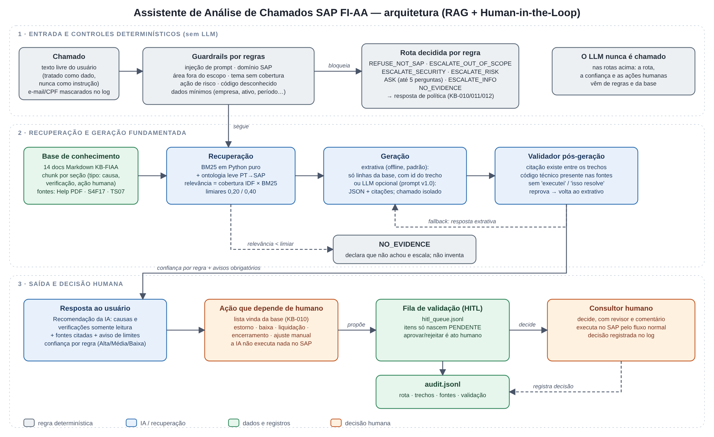
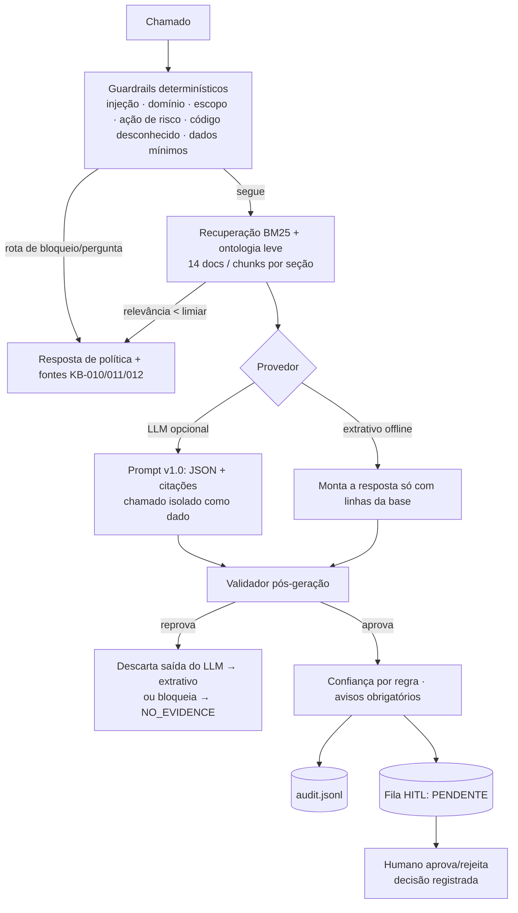

# Assistente de Análise de Chamados SAP FI-AA (RAG + Human-in-the-Loop)

Prova de conceito do *Desafio Técnico — Consultor Funcional (SAP + GenAI)*.
Módulo escolhido: **SAP FI-AA** (Contabilidade de Ativo Imobilizado).

> **Aviso.** Dados, chamados e respostas do SAP são **fictícios ou simulados**. A base de conhecimento foi escrita a partir de documentação pública e material de treinamento (ver `knowledge_base/README.md`) e **precisa ser validada** por um consultor FI-AA antes de qualquer uso real. O assistente **nunca executa ações no SAP**.

## 1. O que o protótipo faz

**Atividade manual transformada:** a triagem e a primeira análise de chamados de ativo fixo (classificar, buscar na documentação, sugerir causas e verificações, pedir dados faltantes). A decisão e qualquer ação no sistema continuam humanas.

Para cada chamado o assistente decide uma **rota** por regras determinísticas (não pelo LLM):

| Rota | Quando | Resultado |
|---|---|---|
| `ANSWER` | Há evidência na base | Causas possíveis e verificações **somente leitura**, com fonte e confiança |
| `ASK` | Faltam dados mínimos (KB-011) | Até 5 perguntas; após 2 rodadas, escala (`ESCALATE_INFO`) |
| `ESCALATE_RISK` | Pedido de estorno, baixa, liquidação, encerramento, ajuste… | Não executa; orienta, lista pré-verificações e envia à **fila de validação humana** |
| `ESCALATE_OUT_OF_SCOPE` | Área FI-AA/SAP fora do escopo (ex.: contabilidade paralela, leasing, customizing, outro módulo) | Não diagnostica; encaminha com resumo |
| `NO_EVIDENCE` | Código de erro desconhecido, tema sem cobertura ou relevância baixa | "Não encontrei evidência"; não inventa; escala |
| `REFUSE_NOT_SAP` | Fora do domínio SAP | Recusa cordial e redireciona |
| `ESCALATE_SECURITY` | Tentativa de burlar regras (prompt injection) | Recusa, registra e encaminha |

## 2. Arquitetura



Versão vetorial: [`docs/diagrama-arquitetura.svg`](docs/diagrama-arquitetura.svg). O fluxo em Mermaid abaixo é equivalente.



| Módulo (`assistente_fiaa/`) | Papel |
|---|---|
| `guardrails.py` | Injeção de prompt, domínio, áreas fora do escopo, temas sem cobertura, ações de risco, dados mínimos (slots) |
| `kb.py`, `retriever.py`, `text.py` | Carga e divisão da base; BM25 em Python puro com termos casados explicáveis; glossário PT↔código SAP (ontologia leve) |
| `generator.py`, `prompts.py`, `llm.py` | Geração extrativa (offline) e via LLM; provedor `anthropic` opcional; `ScriptedProvider` para testes |
| `validator.py` | Barreira anti-alucinação (ver §4) |
| `pipeline.py` | Orquestração, política de rota, confiança por regra |
| `audit.py` | Log JSONL (com mascaramento de e-mail/CPF) e fila HITL |
| `web.py` | Interface web local (só biblioteca padrão, escuta apenas em 127.0.0.1): analisar chamado, fila HITL com aprovar/rejeitar, auditoria e avaliação |
| `avaliacao.py`, `__main__.py` | Avaliação contra o gabarito e CLI |

## 3. Como executar

Requer Python 3.10+. O modo padrão **não precisa de internet, chave ou dependências**.

```bash
git clone <este-repositorio> && cd <pasta>
pip install -r requirements.txt           # só o pytest, para os testes

python -m assistente_fiaa web             # INTERFACE VISUAL no navegador (http://127.0.0.1:8765)
python -m assistente_fiaa demo            # roda os 10 chamados (+ rodadas 2) e imprime as respostas
python -m assistente_fiaa chamado "Na empresa 1000 a depreciação do ativo 100000123 em 09/2026 não foi lançada"
python -m assistente_fiaa interativo      # digite chamados livremente
python -m assistente_fiaa fila            # fila de validação humana
python -m assistente_fiaa fila --decidir HITL-0006 --revisor "maria.silva" --comentario "..."          # rejeita
python -m assistente_fiaa fila --decidir HITL-0006 --aprovar --revisor "maria.silva"                   # aprova
python -m assistente_fiaa avaliar         # gabarito + extras → evidencias/avaliacao_<provedor>/
python -m pytest -v tests                 # 82 testes
```

### Modo LLM (opcional)
Dois caminhos, escolhidos por `--provider` (antes do comando):

**a) Gratuito e local, com Ollama** (nenhum dado sai do computador; só biblioteca padrão no Python):
```bash
# 1) instale o Ollama (https://ollama.com) e baixe um modelo, ex.: ollama pull llama3.1:8b
python -m assistente_fiaa --provider ollama web          # ou demo / chamado / avaliar
# variáveis opcionais: LLM_MODEL (padrão llama3.1:8b), LLM_BASE_URL (padrão http://localhost:11434/v1)
```
O mesmo provedor funciona com qualquer serviço de API compatível com `chat/completions` (Gemini em modo compatível, Groq, OpenRouter etc.), definindo `LLM_BASE_URL`, `LLM_MODEL` e `LLM_API_KEY`. Exemplo com a camada gratuita do Google AI Studio: `LLM_BASE_URL=https://generativelanguage.googleapis.com/v1beta/openai`, `LLM_MODEL=gemini-3.8-flash`. Respostas 429/503 (limite de requisições) são reenviadas com espera (`LLM_RETRY_WAIT`). **Se o log mostrar `llm->extrativo` com "saída do LLM não é JSON válido"**: a mensagem agora traz `finish_reason` e o início/fim do texto devolvido. `finish_reason=length` indica resposta cortada (modelos com raciocínio gastam o limite pensando): aumente `LLM_MAX_TOKENS` (padrão 6000) ou reduza o raciocínio com `LLM_REASONING_EFFORT=low`. Com o Gemini o modo JSON liga sozinho (`LLM_JSON_MODE=0` desliga) e há uma segunda tentativa automática pedindo só o JSON. Observação: o GitHub Models foi descontinuado em 30/07/2026 e não deve ser usado. Termos e limites de camadas gratuitas mudam; confira no site do serviço.

**b) Anthropic:**
```bash
pip install anthropic && export ANTHROPIC_API_KEY=...
python -m assistente_fiaa --provider anthropic demo
```
Nos dois casos o modelo só **redige** dentro dos trechos recuperados; rota, confiança e ações humanas continuam vindo das regras e da base, e a saída passa pelo validador. Se o modelo errar (JSON inválido, citação falsa, código inventado) ou o serviço estiver fora do ar, o atendimento **cai na resposta extrativa** e a violação fica no log. O LLM nunca é chamado nas rotas decididas por regra (injeção, fora do domínio/escopo, sem evidência, perguntas).

**Estado de validação:** testado com servidores simulados (respostas boas, ruins e serviço indisponível; `tests/test_llm_compat.py` e `tests/test_seguranca_e_alucinacao.py`) **e com um modelo real**: o Gemini pela camada gratuita do Google AI Studio (`evidencias/avaliacao_llm_gemini/`). A avaliação completa foi rodada duas vezes pela autora com o mesmo resultado (13 respostas redigidas pelo modelo, 0 fallbacks). Em uma execução anterior o serviço devolveu 503 e o atendimento caiu corretamente na resposta extrativa (`llm->extrativo`); em outra, o JSON vinha cortado por limite de tokens (corrigido, ver §6). O provedor Anthropic e o Ollama local **não** foram exercitados com modelo real. Modelos pequenos locais tendem a errar o formato JSON com mais frequência; o validador existe para isso.

Por que o modo padrão é extrativo? Para a avaliação ser reproduzível sem custo e para garantir fundamentação **por construção**: cada frase vem de uma linha da base, com id do trecho.

## 4. Decisões de projeto, por critério de avaliação

### Qualidade do RAG, prompts e fundamentação
- **Base curada e rastreável:** 14 documentos em Markdown com seções padronizadas (`Quando se aplica`, `Causas`, `Verificações`, `Exige validação humana`, `Referências`). Cada afirmação cita página do PDF SAP Help (`[HELP p.184]`), planilha de treinamento (`S4F17`) ou template de migração (`TS07`). Tipos/tamanhos de campo vêm do TS07 e o assistente sempre avisa que devem ser validados no sistema do cliente.
- **Chunking por seção**, não por tamanho fixo: o tipo da seção (causa, verificação, ação humana) vira metadado e define **onde** o texto aparece na resposta.
- **Recuperação lexical (BM25)** em vez de embeddings: a base é pequena, em português e cheia de identificadores (AFAB, AFABG, FAA_CMP). Busca lexical é auditável (o log mostra os termos que casaram), sem dependências. Uma ontologia leve expande termos do usuário ("baixa" → ABAVN/retirada). Embeddings e *reranking* ficam como evolução.
- **Relevância calibrada:** `relevância = cobertura ponderada por IDF × atenuação pelo BM25 absoluto`; limiares `0,20` (abaixo disso, "sem evidência") e `0,40` (trecho forte). Calibrados à mão em 27 casos (ver limitações).
- **Prompt (v1.0, `prompts.py`):** papel e escopo; regras em ordem de prioridade (segurança > fundamentação > utilidade); só os TRECHOS; citação obrigatória de id de trecho; chamado entre `<chamado>…</chamado>` tratado como dado; saída JSON validada por código; exemplo curto; **a confiança não é pedida ao modelo** (calculada por regra, evitando autoavaliação inflada).
- **Confiança por regra (KB-010):** Alta = trecho forte, ≥2 trechos e ≥2 documentos; Média caso contrário; ação de risco e Integration têm **teto Média**; sem evidência = escala.

### Tratamento de erros, riscos, segurança e alucinações

| Risco | Controle | Teste |
|---|---|---|
| Prompt injection (também embutida em chamado legítimo) | Detecção por padrões antes de qualquer LLM; chamado isolado como dado; tentativa registrada e escalada | `test_variacoes_de_injecao`, `T-10` |
| Execução indevida | O assistente não possui nenhuma ferramenta de escrita; pedidos viram `ESCALATE_RISK` + fila HITL | `test_nunca_executa_acao_de_risco` |
| Código/mensagem inventado | Identificador citado pelo usuário que não existe na base → `NO_EVIDENCE`; validador rejeita código técnico (transação, campo) ausente das fontes | `test_codigo_de_erro_inexistente…`, `test_validador_bloqueia_transacao_inventada` |
| Citação falsa / item sem fonte | Validador exige que cada item cite id de trecho **efetivamente recuperado** | `test_llm_citacao_falsa_e_descartada` |
| Linguagem de execução/garantia ("executei", "isso resolve") | Validador por padrões; resposta descartada | `test_llm_afirma_execucao_e_descartado` |
| Saída do LLM inválida | Fallback para a resposta extrativa, registrando a violação | `test_llm_json_invalido_cai_para_extrativo` |
| Dados incompletos | Perguntas por slot (empresa, ativo, período, campo…), máx. 5/rodada, escala após 2 rodadas | `test_escala_apos_duas_rodadas_sem_dados` |
| Tema vizinho sem cobertura (ex.: imposto diferido) | Lista de temas sem documento → `NO_EVIDENCE` | `test_tema_vizinho_sem_cobertura` |
| Dados pessoais no log | Mascaramento de e-mail e CPF | `test_dados_pessoais_sao_mascarados_no_log` |
| Entradas estranhas (vazia, 5000 caracteres, HTML) | Não quebra | `test_entrada_vazia_ou_estranha_nao_quebra` |

### Human-in-the-Loop
O assistente só cria itens **PENDENTE** na fila (`logs/hitl_queue.jsonl`); aprovar ou rejeitar é um ato humano com revisor e comentário, também gravado no log de auditoria. Toda resposta separa **"Recomendação da IA"** (causas, verificações de leitura) de **"Ação que depende de autorização humana (a IA não executa)"**. Lista completa de ações em `knowledge_base/KB-FIAA-010`.

### Log de auditoria
Cada chamado grava em `logs/audit.jsonl`: data/hora, chamado (mascarado), rota, confiança, HITL, provedor/modelo, versão do prompt, flags dos guardrails, trechos recuperados com score e termos casados, fontes citadas, resposta completa, resultado da validação e latência. Exemplo real em `evidencias/logs/`.

## 5. Evidência de funcionamento

Tudo em `evidencias/` foi gerado pelos comandos acima:

| Arquivo | Conteúdo |
|---|---|
| `demo_saida.md` | Saída completa dos 10 chamados (+ rodada 2) |
| `avaliacao_extrativo/` | Avaliação sem LLM: relatório, resultados e log |
| `avaliacao_llm_gemini/` | Avaliação **com LLM real** (Gemini, Google AI Studio): relatório |
| `pytest.txt` | 82 testes passando |
| `logs/audit.jsonl`, `logs/hitl_queue.jsonl` | Log real e fila HITL |
| `exemplo_decisao_humana.json` | Humano rejeitando o pedido de estorno/reabertura (T-07) |

**Resultados (rotas, HITL e fundamentação):**

| | Extrativo (sem LLM) | LLM real (Gemini, camada gratuita) |
|---|:-:|:-:|
| Gabarito: rota correta / HITL correto | 12/12 · 12/12 | 12/12 · 12/12 |
| Casos extras: rota correta / HITL correto | 17/17 · 17/17 | 17/17 · 17/17 |
| Itens sem fonte | 0 | 0 |
| Recall médio dos documentos esperados | 0,65 | 0,71 |
| Respostas redigidas pelo modelo e validadas | n/a | 13 (0 fallbacks) |
| Respostas decididas por regra (sem chamar o modelo) | 16 | 16 |
| Testes automatizados | 82 passando | |

O teste com o modelo real revelou um defeito do RAG que o provedor simulado não mostrou: o contexto enviado ao LLM não continha a linha da tabela com o tamanho do campo (caso E-03). Foi corrigido (o LLM agora recebe primeiro os trechos que a seleção por regra usou) e protegido por teste de regressão. A avaliação com o Gemini foi rodada **duas vezes pela autora** (03:52 e 17:16 UTC de 18/10/2026) e deu **exatamente os mesmos números** (recall 0,71; 13 respostas do modelo, 0 fallbacks), o que indica estabilidade nesta amostra; não prova que seja sempre assim, e o recall pode variar porque o modelo escolhe o que citar. Entre as duas execuções corrigi um problema encontrado em uso real (o JSON do modelo vinha cortado e o atendimento caía no extrativo; ver §3 e a seção abaixo).

**O que o recall mostra:** a menor cobertura está em T-03 (33%) e T-04 (25% na rodada 1), mas nessas linhas a rota é `ASK` (o assistente só pergunta), então o recall de documentos pouco diz sobre qualidade. Nas respostas completas ele varia de 50% (T-01) a 100% (T-02, T-07).

Cenários exigidos pelo desafio: **sucesso** T-01, T-02, T-09; **exceções** T-03/T-04 (incompleto), T-05 (fora do domínio), T-06 (fora do escopo), T-07 (ação de risco), T-08 (sem evidência), T-10 (injeção). Os 10 chamados e o gabarito estão em `tickets/`.

## 6. Limitações e riscos (leia antes de confiar)
- **Amostra pequena (n = 27).** Os resultados demonstram comportamento, não desempenho estatístico. Na primeira execução **3 de 17 casos extras falharam** (E-06, E-14, E-17); ajustei regras e reexecutei, então os extras **deixaram de ser um teste cego**. Para medir generalização é preciso um conjunto novo, escrito por outra pessoa.
- **Recall de documentos de 0,65.** Em T-01, T-03, T-04 e T-09 o assistente cita menos documentos do que o gabarito espera (ex.: dicionários de campos KB-013/014). Não há erro de rota ou de fundamentação, mas há perda de completude; é o ponto óbvio de melhoria.
- **Ruído de recuperação por palavra-gatilho.** A palavra "estorne" aciona também a seção de baixa (KB-005) em pedidos de estorno de liquidação de AuC: a resposta continua fundamentada e vai à fila HITL, mas traz um trecho pouco pertinente. Falta refinar o mapeamento ação → documento.
- **Guardrails por padrões (regex)** são frágeis a paráfrases, ortografia e outros idiomas. Em produção, combinar com um classificador e testes adversariais contínuos.
- **Base não validada por especialista SAP.** A fonte principal é um PDF que se declara incompleto e não destinado a produção; o TS07 é de 2019. Transações e tamanhos de campo devem ser conferidos no sistema do cliente.
- **Um único modelo real testado, em duas execuções com resultado idêntico** (Gemini, camada gratuita). Anthropic e Ollama só com servidores simulados. Outro modelo, ou o mesmo em outro dia, pode errar o formato JSON: o validador e o fallback extrativo existem para isso.
- **Falha encontrada em uso real, já corrigida:** com modelos que "pensam", o limite de 1500 tokens cortava o JSON e o sistema caía sempre no extrativo. Foram aumentados o limite (6000), o modo JSON do Gemini, uma segunda tentativa e o diagnóstico no log; há testes de regressão. É um exemplo de defeito que só apareceu com o modelo real.
- **Dependência de serviço gratuito:** limites de requisição (429/503) e mudança de modelos ou termos podem afetar a demonstração; o modo extrativo é o plano B.
- **Respostas longas:** a resposta completa traz muitas linhas e fontes; para o usuário final, uma visão curta com "ver detalhes" seria melhor (feito na versão LUME; não aplicado aqui).
- **Sem leitura de dados do SAP.** Em Integration só há orientação documental.
- **Sem autenticação, controle de acesso ou criptografia** nos logs: é um protótipo local.

## 7. Próximos passos

**Qualidade do RAG (antes de qualquer piloto):**
1. Medir a busca separadamente da geração (recall@3 e MRR) com perguntas paráfrase e um conjunto **cego**, escrito por outra pessoa.
2. Busca híbrida (BM25 + embeddings) e indexar as perguntas do FAQ como chave de busca; substituir a ontologia escrita à mão por um glossário gerado das fontes.
3. Resposta curta por padrão, com a análise completa sob demanda.
4. Validação do conteúdo por consultor FI-AA (`revisado_por` e `data_revisao` nos documentos).
5. Testar também Anthropic e um modelo local (Ollama) e registrar os relatórios em `evidencias/`.

**Acesso a dados reais do SAP, com segurança:**
1. **Somente leitura**, via camada de serviço (APIs/OData liberadas pelo time SAP; adequação a confirmar na documentação oficial), nunca com acesso direto ao banco.
2. **Usuário técnico dedicado** com perfil mínimo (princípio do menor privilégio) e objetos de autorização restritos a exibição; credenciais em cofre de segredos, nunca no código ou no prompt.
3. **Propagação da identidade do solicitante**: o assistente só vê o que o usuário já pode ver.
4. **Mascaramento** de dados pessoais e financeiros sensíveis antes do envio a qualquer LLM; avaliar modelo hospedado em região e contrato aprovados pelo cliente.
5. **Escrita jamais pelo assistente:** ações aprovadas na fila HITL são executadas por pessoa autorizada, no fluxo normal do SAP.
6. Registro imutável das consultas e decisões, integrado à auditoria do cliente.

## 8. Como medir ganho de tempo, qualidade e produtividade
Método em `docs/04-metricas-e-medicao.md`: linha de base antes do piloto, indicadores extraídos do próprio `audit.jsonl` (aceite, "sem evidência", perguntas por chamado, 100% das ações de risco com decisão humana) e gate de regressão com este gabarito. **Nenhum ganho é afirmado aqui**; não há linha de base real.

## 9. Estrutura do repositório
```
assistente_fiaa/   código-fonte (pipeline, guardrails, retriever, validator, audit…)
knowledge_base/    14 documentos KB-FIAA-001…014 + README com fontes e índice
tickets/           chamados.json (10 + gabarito), chamados.md, casos_extras.json (17)
tests/             82 testes (gabarito, segurança/alucinação, RAG/auditoria)
evidencias/        saídas geradas: demo, avaliação, pytest, logs
docs/              escopo, diagnóstico de delivery (AS-IS × TO-BE), priorização (valor × viabilidade × risco), plano de adoção, métricas
```
Documentos de consultoria: [escopo](docs/00-escopo-fi-aa.md) · [diagnóstico de delivery](docs/01-diagnostico-delivery.md) · [priorização](docs/02-priorizacao-casos-de-uso.md) · [plano de adoção](docs/03-plano-de-adocao.md) · [métricas](docs/04-metricas-e-medicao.md).
